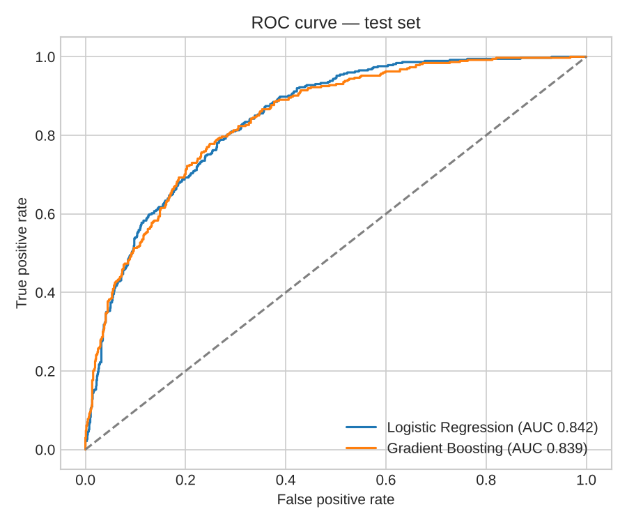
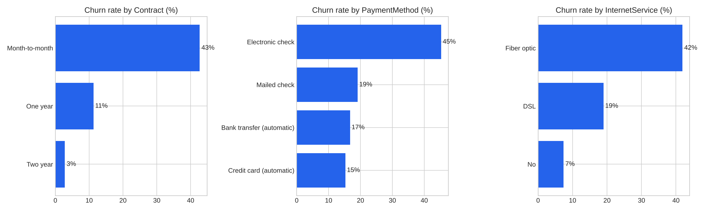
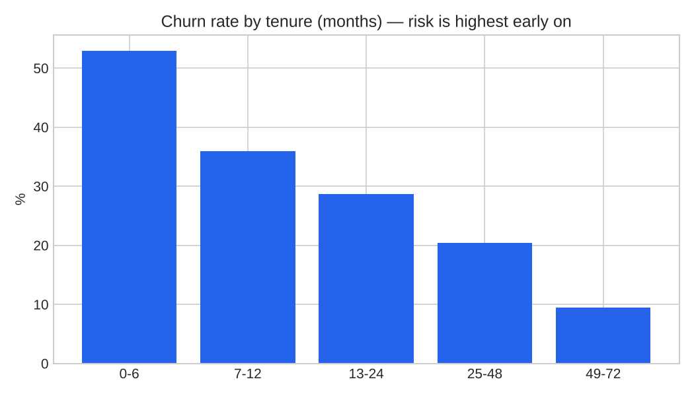
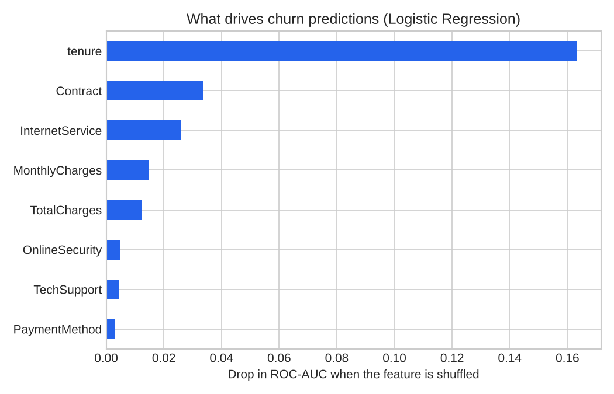
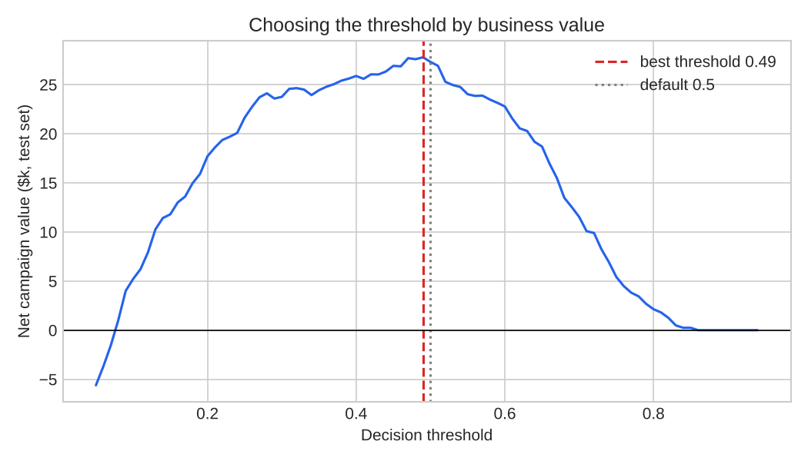

# Customer Churn Prediction — who is about to leave, and is it worth calling them?

A telecoms provider loses **26.5% of its customers**. This project predicts which customers are likely to churn, explains *why*, and turns the model into a decision: **which customers to contact with a retention offer so the campaign actually makes money.**

**Tools:** Python, pandas, scikit-learn, matplotlib · **Data:** [IBM Telco Customer Churn](https://github.com/IBM/telco-customer-churn-on-icp4d) (7,043 customers, 21 columns)

---

## Results at a glance

| | Logistic Regression | Gradient Boosting |
|---|---|---|
| 5-fold CV ROC-AUC | **0.846 ± 0.013** | 0.845 ± 0.009 |
| Test ROC-AUC | **0.842** | 0.839 |
| Test PR-AUC | 0.635 | 0.652 |

The simpler **Logistic Regression** matched the more complex model, so I kept it: it is just as accurate, faster, and every prediction can be explained to a non-technical manager.

**Business outcome (test set of 1,409 customers):** contacting the **330 customers** the model flags catches **214 of 374 churners (57%)** and produces an estimated **+$27.8k net value**. Sending the offer to everyone would *lose* $42.9k.



## What drives churn

| Driver | Churn rate |
|---|---|
| Month-to-month contract | **42.7%** (vs 11.3% one-year, 2.8% two-year) |
| First 6 months as a customer | **52.9%** (vs 9.5% after 4+ years) |
| Fibre optic internet | 41.9% (vs 19.0% DSL) |
| Pays by electronic cheque | 45.3% (vs ~15–17% automatic payments) |




**Recommendations**
1. **Focus on the first 6 months.** More than half of new customers leave in that window, so an onboarding check-in call is the highest-value intervention.
2. **Move customers onto longer contracts and automatic payments**, for example with a small discount for switching from month-to-month or electronic cheque.
3. **Investigate the fibre product.** Fibre customers pay more and churn twice as often as DSL customers, which points to a price or quality problem worth a closer look.



## From probability to decision

A model gives a churn *probability*; the business needs a yes/no "call this customer". Instead of blindly using 0.5, I scored every threshold by **net campaign value**, using assumptions that are stated openly in `src/train.py` and easy to change:

- a retention offer costs **$100** per customer contacted
- it keeps **30%** of the would-be churners who receive it
- a saved customer is worth **12 months of their own bill**

The best threshold was **0.49**, so here the default 0.5 happened to be close to optimal. The point of the exercise is that this is now a *checked* business decision, not an accident: with a cheaper offer the best threshold drops and more customers should be contacted.



## Method

1. **Cleaning:** `TotalCharges` was stored as text with 11 blanks. These were brand-new customers (tenure 0) who hadn't been billed yet, so they were set to 0 rather than dropped.
2. **Feature engineering:** `num_addons`, the number of add-on services (security, backup, tech support, streaming …) per customer.
3. **Preprocessing pipeline:** scaling for numeric columns and one-hot encoding for categorical ones, inside a scikit-learn `Pipeline` so there is no data leakage between training and test.
4. **Validation:** stratified 80/20 split, then 5-fold stratified cross-validation on the training set. The model was chosen on CV score, not on the test set.
5. **Explainability:** permutation importance (model-agnostic) plus logistic-regression odds ratios. For example, a month-to-month contract multiplies the odds of churning by about 1.7× compared with the baseline.

## Limitations and next steps

- The threshold was tuned on the test set; with more data I would tune it on a separate validation set.
- The cost assumptions are illustrative; in a real business they would come from finance and from past campaign results.
- Next: calibrate probabilities, try SHAP for per-customer explanations, and build a Power BI page listing the high-risk customers for the retention team.

## Run it

```bash
pip install -r requirements.txt
python src/train.py      # prints metrics, writes charts and outputs/results.json
```
